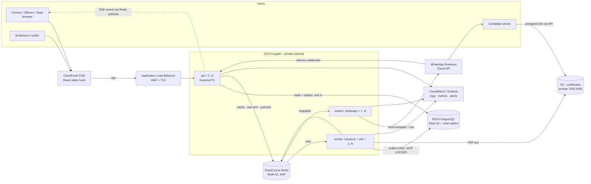

# CertiFlow – Production deployment plan

**Load to plan for:** 100,000 registered users, ~10,000 daily active. Peak on results day: **500 batches approved in 1 hour, so ~30,000 PDFs and ~30,000 WhatsApp messages**. Public verification: thousands of lookups a day, in bursts.

Peak in per-second terms is small: 30,000 / 3,600 s ≈ **8.3 certificates/s**. The design goal is therefore not raw throughput. It is **staying correct while things fail**, and **clearing a backlog predictably** when a dependency (WhatsApp) is down.

---

## 1. Architecture

**Event flow:** an API transaction writes the state change and an `outbox` row together. The relay (in the worker) moves outbox rows onto BullMQ queues: `BatchApproved` → **issuance** (create certificate rows) → `CertificateIssued` → **pdf** (render, upload to S3) → `CertificatePdfReady` → **whatsapp** (send). Every event is also published on Redis pub/sub, and each API instance forwards it to its connected browsers over SSE.

## 2. Where each component is hosted, and why

Region: **AWS ap-south-1 (Mumbai)**. Candidate data (names, phones) is personal data of Indian residents, so we keep it in India (DPDP Act) with low latency to users.

| Component | Hosting | Why |
|---|---|---|
| Frontend | S3 + CloudFront | Static files: cheap, cached at the edge, no servers. |
| API | ECS Fargate service, ≥ 2 tasks across 2 AZs, behind ALB + AWS WAF | Stateless containers (same image as local). No servers to patch. WAF adds IP rate rules on `/api/public/*`. |
| Workers | ECS Fargate services: `worker-core` (relay + issuance + pdf) and `worker-whatsapp` | Same image, split so a WhatsApp outage can't starve PDF generation, and each scales on its own queue depth. |
| PostgreSQL | RDS PostgreSQL 16, Multi-AZ, gp3, automated backups + PITR (7–35 days) | The source of truth. All correctness rules (unique indexes, triggers, sequence) live here. Managed failover in ~1–2 min. |
| Redis | ElastiCache Redis 7, primary + replica (Multi-AZ), AOF | Queues, cache, rate limiting, pub/sub. Managed failover. |
| Certificate files | S3 bucket (private, Block Public Access, SSE-KMS, versioning, Object Lock in governance mode) | Durable, cheap. Object Lock means an issued PDF can't be silently replaced. |
| Secrets | AWS Secrets Manager (JWT and download-link keys, DB password) | Rotatable, never in images. |
| Identity | State SSO / OIDC (e.g. Cognito federated) replacing demo login | MFA for officers and state office. |

## 3. Scaling

**What scales horizontally**

| Part | Scales by | Notes |
|---|---|---|
| api | ECS target tracking on CPU (60 %) + ALB request count | Stateless. SSE fan-out works across instances through Redis pub/sub. |
| worker-core | ECS step scaling on **`pdf` queue waiting count** (custom CloudWatch metric) | One PDF ≈ 50–150 ms CPU. 2 tasks × 4 concurrency clear 30k in well under an hour. Scale out to 6 for a 10–15 minute catch-up. |
| worker-whatsapp | queue depth, **but capped by provider rate** | Concurrency is cheap. The real cap is the provider. |
| Outbox relay | runs in every worker-core task | `FOR UPDATE SKIP LOCKED` means relays never fight over rows. |
| Verification | Redis cache (30 s TTL) + CloudFront in front of `/api/public/verify` with `Cache-Control: no-store` (so cancelled certs aren't cached at the edge) | A burst of a few thousand lookups is a few thousand Redis GETs: trivial. |

**What limits throughput at peak**
1. **WhatsApp provider throughput tier.** Meta's Cloud API allows a business phone number a fixed messages-per-second tier, and new numbers also start with a daily cap on business-initiated conversations. A global BullMQ limiter (`WHATSAPP_RATE_PER_SEC`, shared through Redis across all workers) keeps us under the tier rather than getting throttled. At 50 msg/s, 30,000 messages take ~10 minutes. Action: get the number to a high messaging tier **before** results day.
2. **Postgres write volume.** Per certificate: ~1 certificate row + 1 delivery row + ~3 outbox rows + ~2 audit rows ≈ 7 writes. At 8 certs/s that's ~60 writes/s. A `db.t4g.large`/`r6g.large` handles this easily. The issuance transaction per batch (≤ 500 rows) is short.
3. **Connection count.** Each task uses a pool of 10. With 10 tasks that's 100 connections. Add **RDS Proxy** if we go past ~20 tasks.

**How the backlog is cleared.** Work is never lost, only delayed. Queues persist in Redis (AOF) and the outbox persists in Postgres. Scaling policy: if `pdf` waiting > 2,000 or oldest job > 5 min, add worker-core tasks (max 10). WhatsApp retries use exponential backoff (2 s → … → ~4 min over 8 attempts). After that the delivery is marked `FAILED` and shows on the state desk's **Retry** list. After an outage, "retry all failed" re-enqueues them, and they go out at the rate-limited pace. The idempotency key is reused, so nobody gets a second copy.

## 4. Failure handling

| Failure | What happens | Why it stays correct |
|---|---|---|
| **Worker crash mid-job** | BullMQ marks the job *stalled* after its lock expires (~30 s) and another worker re-runs it. ECS replaces the task. | Every handler is idempotent: `issueBatch` checks `ISSUED` and relies on `UNIQUE(candidate_id)`; PDFs are written to temp then renamed, and `PENDING→READY` is conditional; WhatsApp skips `SENT` and reuses the same idempotency key. A crash between "enqueue" and "mark outbox published" re-enqueues with the same job id, which is de-duplicated. |
| **Redis restart / failover** | ElastiCache promotes the replica. AOF keeps queued jobs. ioredis reconnects automatically. | Anything not yet relayed is still in the Postgres outbox and gets relayed once Redis is back. Verification falls back to the database (cache is optional). The rate limiter fails **open** (keep verifying). Revocations still take effect because a revoke writes the DB first, and the cache TTL (30 s) bounds staleness if the delete didn't reach Redis. Live UI updates pause, and the browser's EventSource reconnects automatically. |
| **WhatsApp outage** | Sends fail fast (3 s timeout) and back off exponentially. Only the `whatsapp` queue grows. Issuance and PDFs carry on. | One delivery row per certificate, with a stable idempotency key. Alert fires (see below). After all retries are used up, deliveries show on the state desk and are retried in bulk. Candidates can also get the PDF from their centre (staff download) meanwhile. |
| **Slow database** | API requests slow down, and the ALB health check (`/ready`) removes unhealthy tasks. Workers' jobs take longer (queues absorb it). | Production config: Postgres `statement_timeout` (5 s for API, 30 s for workers) so slow queries fail rather than hang pools (not set in the local compose). Lock waits are short because transactions are small. Reads for lists can go to the read replica. Alert on p95 latency and `pg_stat_activity` waiting. |
| **AZ loss** | Multi-AZ RDS + ElastiCache fail over. ECS reschedules tasks in the surviving AZ. | No local state on tasks. Files are in S3. |
| **Bad deploy** | ECS rolling deploy with circuit breaker auto-rollback. Migrations run as a one-off task **before** the new version, and are always backward compatible (expand → migrate → contract). | |

## 5. Certificate file storage and access control

- Bucket `certiflow-certificates-prod`: **private**, Block Public Access on, SSE-KMS with a dedicated key, versioning, Object Lock (governance, 10 years). Key layout: `certs/<year>/<certNumber>.pdf`. Lifecycle rule moves files to S3 Standard-IA after 90 days.
- **Only the worker task role can `PutObject`.** The API task role can only `GetObject`. Nobody has `DeleteObject` outside a break-glass role.
- Candidates never get an S3 URL directly in WhatsApp. They get a **signed CertiFlow link** (HMAC, 30-day expiry, bound to one certificate). The API checks the certificate is **not revoked**, logs the download, then redirects to an S3 **presigned URL valid for 60 s**. Cancelling a certificate immediately stops downloads.
- Staff downloads go through the same check plus role and centre authorisation.
- PDFs carry a QR code to the public verify page, which is the real source of truth. A doctored PDF still fails verification.

## 6. Monitoring and alerting

**Logs:** structured JSON (pino) to CloudWatch Logs. Every line carries `traceId`, so one search shows the request, the events and every job for a batch. Phone numbers and tokens are redacted.
**Traces (next step):** OpenTelemetry → AWS X-Ray, using the same trace id.
**Business trace in-app:** `/api/batches/:id/trace` and the certificate history on the state desk.

| Metric | Alert when | Severity |
|---|---|---|
| Oldest unpublished outbox row age | > 60 s | Page: the relay is down |
| `whatsapp` queue waiting / failed rate | failed > 10 % over 5 min, or waiting > 5,000 | Page during results day, ticket otherwise |
| `pdf` / `issuance` queue oldest job age | > 10 min | Page |
| Deliveries in `FAILED` | > 0 new in 15 min | Ticket (state desk shows them too) |
| Escalations raised per day | trend | Weekly report to programme office (this is the business KPI) |
| API 5xx rate / p95 latency | > 1 % / > 800 ms for 5 min | Page |
| `/api/public/verify` 429s | spike | Investigate scraping |
| RDS CPU, connections, replica lag; Redis memory, evictions | standard thresholds | Page on evictions (must be 0, as it would drop jobs: `maxmemory-policy noeviction`) |

Dashboards: one per flow (approvals funnel, issuance pipeline, verification), plus BullMQ queue panels.

## 7. Rough monthly cost (ap-south-1, on-demand, USD)

These are planning estimates to sanity-check in the AWS Pricing Calculator. They are not quotes.

| Item | Size | ≈ USD / month |
|---|---|---|
| ECS Fargate – api | 2 × (0.5 vCPU, 1 GB), 24×7 | 35 |
| ECS Fargate – workers | 2 × (1 vCPU, 2 GB) baseline + results-day bursts | 70 |
| RDS PostgreSQL | db.t4g.large, Multi-AZ, 100 GB gp3, backups | 220 |
| ElastiCache Redis | cache.t4g.small × 2 (primary + replica) | 50 |
| ALB + WAF | 1 ALB, basic rules | 35 |
| NAT gateway | 1 (data processing light) | 40 |
| S3 + CloudFront | ~100k PDFs/year × ~60 KB ≈ 6 GB/yr, static site | 5 |
| CloudWatch logs/metrics, Secrets Manager | 30-day log retention | 30 |
| **Infrastructure total** | | **≈ 485** |
| WhatsApp messages | ~8,000–10,000 utility-template messages/month (more on results day) | Per-message fee set by Meta's current India rate card. Likely the largest *variable* cost, so budget it separately. |

**Trade-offs behind the numbers**
- **Managed services over self-hosting** (RDS/ElastiCache over Postgres/Redis on EC2) cost more per month but remove patching, backups and failover work. That's the right call for a government programme with a small ops team.
- **Fargate over EC2/Kubernetes:** a bit more per vCPU, but no cluster to run. With this load, EKS's control plane and operational overhead aren't justified.
- **BullMQ on Redis over SQS/Kafka:** one fewer system, and it's the same stack as local. SQS would be the swap if we wanted fully managed queues with no Redis durability concerns. The outbox pattern makes that switch local to the relay.
- **Single region:** a regional outage means downtime but no data loss (cross-region backups for RDS and S3 replication would be the next step if the SLA demands it).
- **Cost levers:** Savings Plans (~30 %), scaling workers to 1 task outside results season, a smaller RDS instance off-peak (with care).
